<!-- LOGO -->
<p align="center">
  
</p>

# Clawd Mochi 🦀🤖

**English: [README.en.md](README.en.md)** — 本文件是默认版本；两份如有出入，以这份为准。

一个实体桌面摆件，灵感来自 **Clawd** —— Anthropic 的 Claude Code 那只像素螃蟹吉祥物。一块 ESP32-C3 驱动 1.54 寸彩屏，并自带一个手机网页控制器 —— 不需要装 App、不需要联网、不依赖云服务。

**成本：约 ¥50 · 制作时间：约 1 小时 · 难度：入门**

Instagram 支持项目：[](https://instagram.com/clawd.mochi)

📦 可打印外壳在 MakerWorld：[https://makerworld.com/en/models/2559505-clawd-mochi-physical-claude-code-mascot#profileId-2820000](https://makerworld.com/en/models/2559505-clawd-mochi-physical-claude-code-mascot#profileId-2820000)

---

> ⚠️ 这是一个独立的粉丝项目，与 Anthropic 无隶属、赞助或背书关系。"Claude" 与 "Clawd" 是 Anthropic 的商标。

---

<p align="center">
  
  &nbsp;
  
</p>

## 它能做什么

Clawd Mochi 放在桌面上，用一块小彩屏播放动画表情。连上它自带的热点，就能用手机或电脑的浏览器控制：

- **主题动画** —— 宠物的表情是从文件系统里读出来播放的动画贴纸，换一套主题不必重新烧录固件
  （`idle`、`thinking`、`working`、`done`、`error`、`sleep` 等 12 个状态，清单见「自定义」一节）
- **Claude Code** —— 显示 "Claude Code" 界面，带一个可交互的小终端
- **画布** —— 用手机在屏幕上实时画画

---

## 元器件清单

| 元件 | 规格 | 参考价 |
| ------------------- | -------------------------------- | ------ |
| ESP32-C3 Super Mini | 带 WiFi 的微控制器 | ¥18 |
| ST7789 1.54" TFT | 240×240 SPI 彩屏 | ¥22 |
| 8 根短线 | 8–10 cm 杜邦线 | ¥4 |
| 2× M2×6mm 螺丝 | 固定屏幕压边 | ¥1 |
| 双面胶 | 把元件固定在壳内 | ¥1 |
| USB-C 线 | 供电 | — |
| 3D 打印外壳 | PLA 或 PETG，约 30g | ¥4 |

**合计：约 ¥50**

---

## 接线

> ⚠️ VCC 只能接 **3.3V**，绝不要接 5V。SPI 用 GPIO 8 和 10（硬件 SPI，速度快）。不要用 GPIO 6/7 做 SPI。

| 屏幕引脚 | ESP32-C3 GPIO | 建议线色 |
| ----------- | -------------- | ---------------------- |
| VCC | 3V3 | 红 |
| GND | GND | 黑 |
| SDA | GPIO 10 (MOSI) | 橙 |
| SCL | GPIO 8 (SCK) | 绿 |
| RES | GPIO 2 | 紫 |
| DC | GPIO 1 | 蓝 |
| CS | GPIO 4 | 白 |
| BL | GPIO 3 | 黄 |

---

## 软件

这台设备上跑的是 **ESP-IDF** 固件（`esp-idf/` 目录），不是 Arduino sketch。仓库里的 `clawd_mochi.ino` 是最初的 Arduino 单文件版本，保留作为历史。

- **拿到成品设备的人**：不需要编译任何东西 —— 插上 USB、连它的热点、用浏览器控制，见下一节「怎么用它」；Windows 上另有一份分步说明（含一段可以让 AI 代做的提示词）：[中文（默认）](WINDOWS-SETUP.md) · [English](WINDOWS-SETUP.en.md)
- **要自己做一台、或改固件的人**：见 [esp-idf/README.md](esp-idf/README.md)（与 Arduino 版的差异、启动流程、完整的串口/BLE 命令表）

---

## 怎么用它

### 连上它，打开控制器

1. 用 USB-C 给它供电（任何 USB 充电器或充电宝都行）
2. 等约 3 秒，开机动画结束
3. 在手机或电脑的 **WiFi 设置** 里
4. 连接网络 **`ClaWD-Mochi`** · 密码 **`clawd1234`**（出厂默认 —— 网页里的设备卡片能改这两项，同一个名字也用于蓝牙广播）
5. 打开浏览器访问 **`http://192.168.4.1`**

你会看到网页控制器：


### 控制器功能

| 按钮 / 控件 | 作用 |
| ------------------ | ----------------------------------------------- |
| Idle | 播放主题的"空闲"动画 |
| Done | 播放主题的"完成"动画 |
| Claude Code | 显示代码界面，打开终端 |
| Canvas | 进入绘画模式 —— 用手机在屏幕上画 |
| Pet BG | 宠物透出来的底色（存 NVS，重启保留） |
| Canvas BG | 画布的底色（与上面独立） |
| Pen color | 画布画笔颜色 |
| Display on/off | 背光开关 |
| Brightness | 背光亮度 0–100%（存 NVS，重启保留） |
| Expression | 播放主题提供的任意状态 |
| Upload theme | 替换设备上的主题包 —— 见"自定义"一节 |
| ✓ done（画布内） | 退出画布模式 |

宠物还会打盹：连续两分钟没有任何东西驱动它，就切到主题的 `sleep` 状态，下一次状态请求时醒来。任何命令都会重置这个计时，但只有**状态切换**能把它唤醒 —— 显示一行状态文字不该吵醒它。可以用串口或 BLE 发 `sleepafter <秒>` 改这个间隔（0 表示关闭）；它存在 NVS 里，**重启后保留**（默认 120 秒）。

**但它不会在干活的时候睡过去**：只要屏幕上还是 `working` 或 `thinking`，打盹就不触发。一个跑得久的工具调用期间不会有任何事件，光看"多久没消息"分不出"还在跑"和"卡死了"；这里选的是不动 —— 宠物睡着比假装还在忙更糟。代价是硬杀掉的会话（没有 `Stop`、也没有 `SessionEnd`）会让它一直醒着，直到下一个状态请求。

---

## 3D 外壳

电子件外壳（主体 + 后盖）在 `clawd_mochi` 模型目录里：

| 文件 | 说明 |
| ------------------------------------------------------------------------------------ | ----------------------------------------- |
| [`./models/clawd_mochi/clawd_mochi_v1.stl`](./models/clawd_mochi/clawd_mochi_v1.stl) | 主体外壳（含前壳与后盖） |

### 打印参数

| 参数 | 值 |
| ------------ | ----------------------------------- |
| 材料 | PLA 或 PETG |
| 层高 | 0.15–0.20 mm |
| 填充 | 15% gyroid |
| 支撑 | 需要 —— 屏幕窗口有悬空 |
| 摆放 | 面朝下，背面平贴打印板 |

建议配色：主体橙色 PLA，后盖哑光黑。

也可以从 MakerWorld 下载模型：[https://makerworld.com/en/models/2559505-clawd-mochi-physical-claude-code-mascot#profileId-2820000](https://makerworld.com/en/models/2559505-clawd-mochi-physical-claude-code-mascot#profileId-2820000)

### 纯 3D 版 Clawd（不含电子件）

如果你只想要一个摆件，用单独的 3D Clawd 模型（没有屏幕和电子件的开孔）。


模型文件：

| 文件 | 说明 |
| ---- | ----------- |
| [`./models/clawd_3d/clawd_3D_no_AMS.stl`](./models/clawd_3d/clawd_3D_no_AMS.stl) | 原始 Clawd 3D 模型 |
| [`./models/clawd_3d_squished_eyes/clawd_3D_squished_eyes_no_AMS.stl`](./models/clawd_3d_squished_eyes/clawd_3D_squished_eyes_no_AMS.stl) | 眯眼版本 |

也可以从 MakerWorld 下载：[https://makerworld.com/en/models/2576503-clawd-claude-code-mascot#profileId-2841183](https://makerworld.com/en/models/2576503-clawd-claude-code-mascot#profileId-2841183)

---

## 组装提示

1. 先打印外壳（主体 + 后盖），**先试装屏幕再上胶**
2. 焊接前先把 8 根线穿过后盖的过线槽
3. 用双面胶把 ESP32 固定在后盖内侧
4. 用 2× M2×6mm 螺丝穿过压边孔固定屏幕
5. USB-C 线走线槽引出，扣上后盖

---

## 自定义

### 主题（动画）

宠物的表情来自**主题包**：一个目录里放着纯文本 manifest（把状态名映射到 `.caf` 动画文件）加上那些 `.caf`，所以改某个状态的样子只是编辑文件的事 —— 不需要动固件。

```
themes/clawd/manifest.txt   # state=file，一行一个，另有 scale=N
themes/clawd/*.caf          # 由 tools/gif2caf.py 从 GIF 转换而来
themes/clawd.zip            # 打包给设备的那一个文件（tools/mochi_theme.py bundle）
```

设备上**只放得下一个包** —— 2.44 MB 的 LittleFS 分区刚好够装一组约 2 MB 的包，没有余地，所以"换主题"就是替换。装法是把它加进网页 `// theme` 区的主题库再推给设备：整个 `.zip` 一次请求发过去，设备按包里的目录预先核对解压体积，装不下就直接拒绝 —— 拒绝和失败都会把**固件内置的那套**装回去，不会留下一个空主题。`restore built-in` 按钮手动做同一件事。

内置的是 `themes/clawd`（螃蟹）里 Claude Code 驱动的那 **6** 个状态，固件把它压缩后烘在 app 分区里（`esp-idf/main/default_pack.zip`，168 KB），所以设备什么都不推也有一张脸。6 个备用素材不在里面 —— 全 12 个压缩后是 384 KB，而 app 分区只剩 240 KB 的余量。内置那套的原理见 [CLAUDE-CODE-BRIDGE.md](CLAUDE-CODE-BRIDGE.md)。

仓库里现有五套包（螃蟹 `clawd` 12 个状态、原版橙色方块宠 `origin` 11 个、三花猫 `calico` 10 个、云朵 `cloudling` 10 个、只有表情整屏黑边的 `face` 11 个），**每个状态的预览动图、打包与安装方式**都在 [`themes/`](themes/README.md) —— 打开那个目录就是那份索引。

等待时间要按这套分区的性子算：littlefs 的写入粒度是 128 字节，落盘大约 **78 KB/s**，而网页上的进度条只覆盖传输。传完之后才是真正慢的那段 —— 2 MB 的包要再写 **25 秒**左右，`themes/origin`（296 KB）约 4 秒。刚烧完固件的第一次开机同理：设备要先把 892 KB 的内置包写进分区，面板会停在开机画面上约 11 秒。

### 设备上现有的状态

这组主题一共 12 个状态，体积合计约 **2.0 MB** —— 分区是 2.44 MB，这就是"只装得下一组"的原因。下面每个动图都是**从 `.caf` 逐帧解码**渲染的（480×480，即面板的 2 倍），所以它显示的就是面板上实际的效果。

**前六个由 Claude Code 驱动**：

<table>
  <tr>
    <td align="center">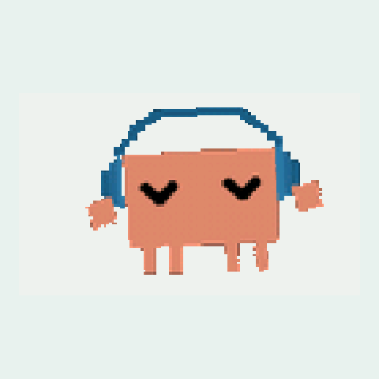<br><code>idle</code></td>
    <td align="center">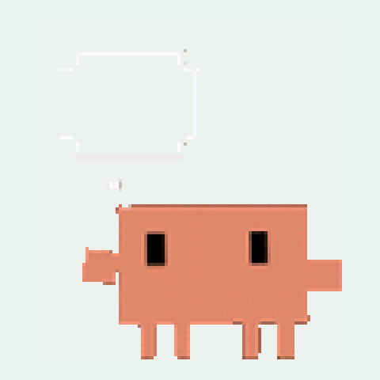<br><code>thinking</code></td>
    <td align="center">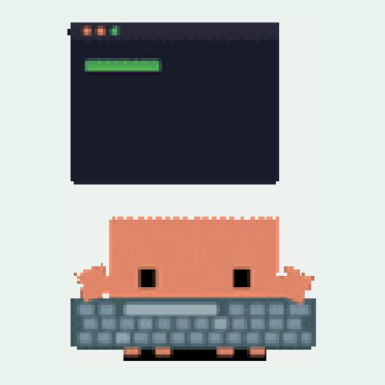<br><code>working</code></td>
  </tr>
  <tr>
    <td align="center">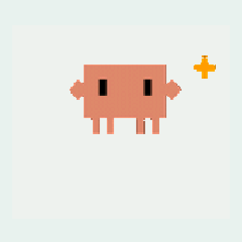<br><code>done</code></td>
    <td align="center">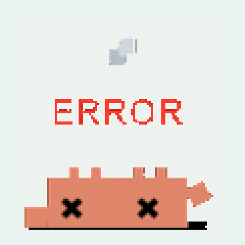<br><code>error</code></td>
    <td align="center">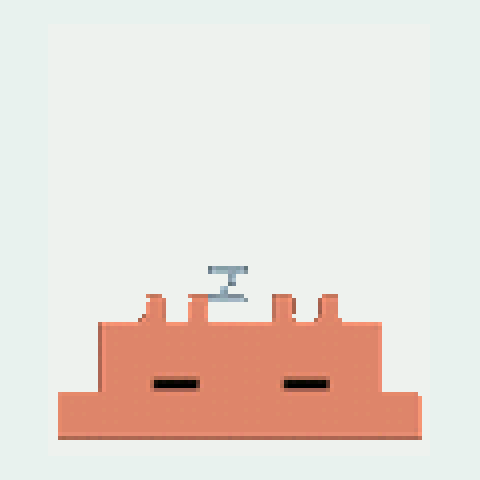<br><code>sleep</code></td>
  </tr>
</table>

| 状态 | 什么时候出现 |
| --- | --- |
| `idle` | 空闲 —— 开机之后，或点网页上的 Idle |
| `thinking` | 提交了提示（hook：`UserPromptSubmit`） |
| `working` | 工具正在跑（hook：`PreToolUse`） |
| `done` | 一轮回答结束（hook：`Stop`）—— 只在**最后一个**干活的会话停下来时播 |
| `sleep` | 静置两分钟自动打盹（间隔可调，见上文）；屏幕上还是 `working`/`thinking` 时不打盹 |
| `error` | **目前没有自动来源** —— 用 `state error` 或网页的 Expression 手动播放 |

有几个 Claude Code 会话同时在跑的时候，屏幕显示的是**最忙的那个**（`working` > `thinking` > `idle`）：某个会话结束不会把屏幕从别的会话手里夺走，也不会让宠物提前睡过去。会话靠 hook 输入里的 `session_id` 区分，细节见 [`CLAUDE-CODE-BRIDGE.md`](./CLAUDE-CODE-BRIDGE.md) §方案 E。

**后六个是主题自带的备用素材** —— 把 `manifest.txt` 里某个状态指过去即可（例如 `idle=clawd-idle.caf` 就换掉默认的空闲动画）：

<table>
  <tr>
    <td align="center">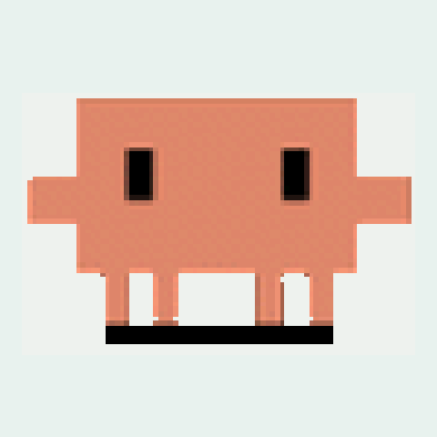<br><code>spare-idle</code></td>
    <td align="center">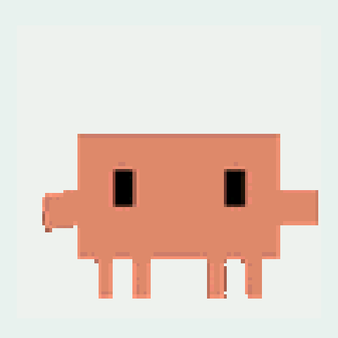<br><code>spare-reading</code></td>
    <td align="center">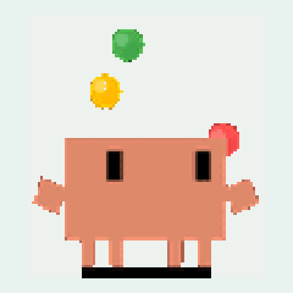<br><code>juggling</code></td>
  </tr>
  <tr>
    <td align="center">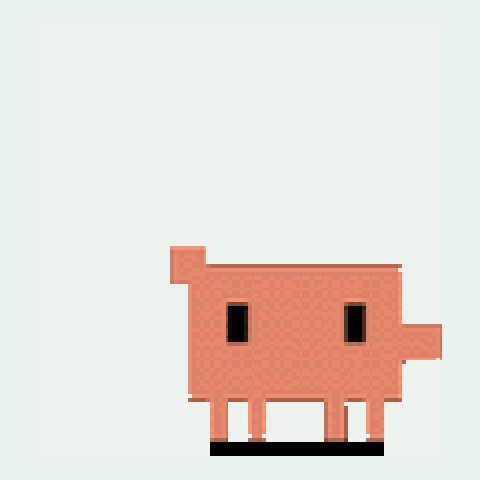<br><code>notification</code></td>
    <td align="center">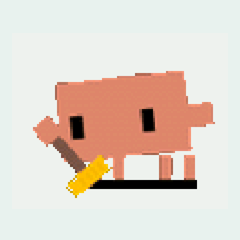<br><code>sweeping</code></td>
    <td align="center">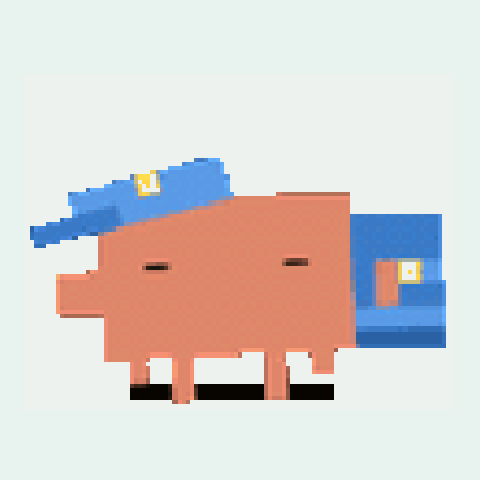<br><code>carrying</code></td>
  </tr>
</table>

| 状态 | 动画文件 | 帧数 | 单次循环 | 体积 |
| --- | --- | --- | --- | --- |
| `idle` | `clawd-headphones-groove.caf` | 48 | 3.2 s | 167 KB |
| `thinking` | `clawd-thinking.caf` | 45 | 3.0 s | 139 KB |
| `working` | `clawd-typing.caf` | 45 | 3.0 s | 281 KB |
| `done` | `clawd-happy.caf` | 45 | 3.0 s | 94 KB |
| `error` | `clawd-error.caf` | 45 | 3.0 s | 125 KB |
| `sleep` | `clawd-sleeping.caf` | 45 | 3.0 s | 84 KB |
| `juggling` | `clawd-juggling.caf` | 45 | 3.0 s | 153 KB |
| `notification` | `clawd-notification.caf` | 77 | 5.6 s | 265 KB |
| `sweeping` | `clawd-sweeping.caf` | 45 | 3.0 s | 151 KB |
| `carrying` | `clawd-carrying.caf` | 45 | 3.0 s | 196 KB |
| `spare-idle` | `clawd-idle.caf` | 48 | 3.2 s | 132 KB |
| `spare-reading` | `clawd-idle-reading.caf` | 60 | 4.0 s | 266 KB |

设备上随时可以列出当前主题提供了哪些状态：串口/BLE 发 `states`，或看网页 `// theme` 区那个下拉框。上面这些动图可以用 `python3 tools/theme_gifs.py themes/clawd pics/states` 重新生成（改了主题之后跑一次）。

把一套贴图打包成主题包，再打成设备收的那一个文件：

```bash
python3 tools/mktheme.py ../stickers/128/calico -o themes/calico \
        --scale 2 --no-upscale
python3 tools/mochi_theme.py bundle themes/calico -o themes/calico.zip
```

`mktheme` 会打印打包后的体积与分区预算的对比，所以一个过大的包在推送前就能看出来，而不是传到一半才发现。`tools/mochi_theme.py` 是整条流水线的入口 —— `convert`、`pack`、`bundle`、`verify`、`preview` —— 其中 `preview` 最值得知道：

```bash
python3 tools/mochi_theme.py preview themes/calico -o /tmp/calico.png
```

它把**屏幕实际会显示的样子**渲染出来 —— manifest 里的 `scale`、以你的背景色透出的透明区域、画面在存储位置上的取值 —— 所以不用烧录就能判断一组包好不好。建议推送前先跑一次。

**决定一组贴图能不能装下的有两个因素**，而且它们互相影响：

- **素材分辨率。** 这些贴图集有多个尺寸，占空间的是画本身而不是画布。`stickers/calico/` 把螃蟹画成 205x155，六个状态加起来 3.6 MB；`stickers/128/calico/` 画成 96x74，同样六个状态只有 991 KB。
- **是存大图还是让设备放大。** 行程编码只在像素锐利时才紧凑，所以在转换阶段放大既费字节又伤锐度。`--no-upscale --scale 2` 把小图存下来、由固件在推送时放大：cloudling 的 idle 动画因此从 481 KB 降到 203 KB，画面完全一样。

另外还有 `--stride N`：每 N 帧保留一帧，把被丢掉那几帧的时长折算到留下的帧上，动画总时长不变 —— 这是拿流畅度换体积，而不是偷偷把主题放快。

播放速度来自主题包本身、不来自固件：每个 `.caf` 里存着从源 GIF 取的每帧时长，所以 8 fps 做的主题和 17 fps 做的主题各按自己当初的节奏播放。背景色用串口或 BLE 的 `bg#RRGGBB` 设置，并存在 NVS 里（重启后保留）；每一帧的调色板索引 0 都是透明的，所以 `.caf` 里烘死的那个颜色永远不会显示出来。

### 原版主题：橙色方块宠（`themes/origin`）

仓库里另有一套主题包，角色不是上游贴图集里的螃蟹，而是产品图上那只**橙色方块宠**：方脑袋、两侧小耳朵、正面一块黑框屏幕、下面三条腿，表情用像素画在屏幕里。

它的美术没有来源 —— 贴图集里没有这个角色 —— 所以它是**用代码画出来的**：`tools/origin_art.py` 逐帧渲染 240×240 的像素画，再交给同一条流水线转成 `.caf`。想改它的样子就是改那个脚本里的几个数。

设备状态到表情的对应（`idle` 用"待机中"的平眼，因为宠物绝大多数时间停在这个状态）：

| 状态 | 表情 | 文件 | 帧数 | 单次循环 | 体积 |
| --- | --- | --- | --- | --- | --- |
| `idle` | 待机中（两条竖杠，会眨眼） | `origin-standby.caf` | 24 | 2.9 s | 45 KB |
| `thinking` | 思考中（方眼 + 腮红，眼珠左右瞟） | `origin-thinking.caf` | 16 | 1.6 s | 31 KB |
| `working` | 工作中（`</>` + 一行滚动的代码） | `origin-coding.caf` | 20 | 1.6 s | 50 KB |
| `done` | 完成啦（闪光眼 + 腮红，原地小跳） | `origin-done.caf` | 16 | 1.3 s | 33 KB |
| `error` | 出错（XX 眼 + 下弯嘴，全身一抖） | `origin-error.caf` | 12 | 1.1 s | 26 KB |
| `sleep` | 打盹（闭眼 + 冒 z） | `origin-sleeping.caf` | 24 | 3.6 s | 46 KB |
| `spare-happy` | 开心（`^^` 眼 + 腮红 + 笑口） | `origin-happy.caf` | 16 | 1.1 s | 33 KB |
| `spare-slack` | 摸鱼中（墨镜 + 反光扫过） | `origin-slack.caf` | 16 | 1.9 s | 30 KB |
| `spare-grin` | 大笑（眯眼 `◡◡` + 张嘴跳） | `origin-grin.caf` | 16 | 1.1 s | 33 KB |
| `spare-shine` | 闪亮（菱形星芒眼 + 腮红） | `origin-shine.caf` | 16 | 1.4 s | 36 KB |
| `spare-blank` | 无语（两个方点 + 一条平嘴） | `origin-blank.caf` | 24 | 3.4 s | 43 KB |

<table>
  <tr>
    <td align="center"><br><code>idle</code> 待机中</td>
    <td align="center"><br><code>thinking</code> 思考中</td>
    <td align="center">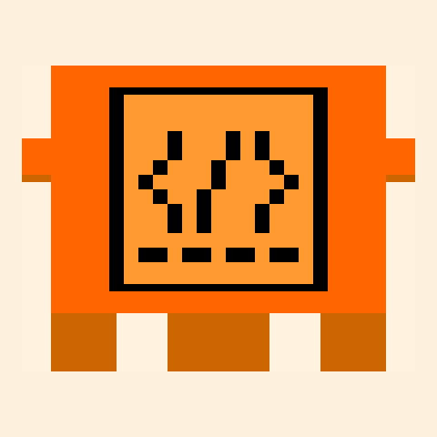<br><code>working</code> 工作中</td>
  </tr>
  <tr>
    <td align="center">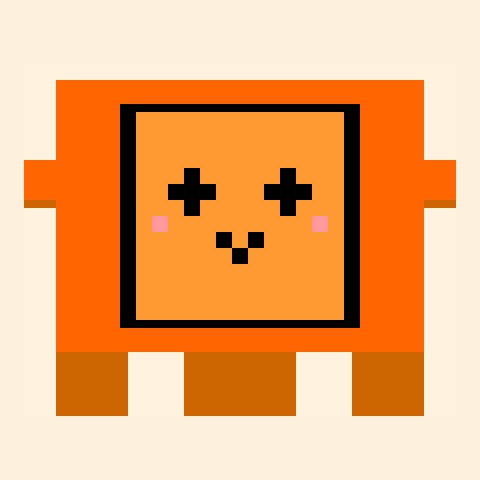<br><code>done</code> 完成啦</td>
    <td align="center">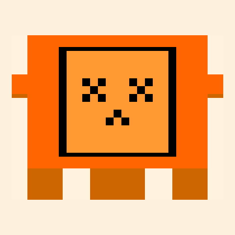<br><code>error</code> 出错</td>
    <td align="center">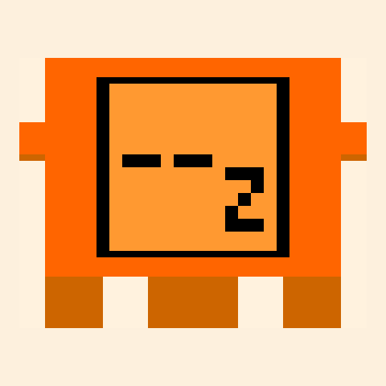<br><code>sleep</code> 打盹</td>
  </tr>
</table>

<table>
  <tr>
    <td align="center"><br><code>spare-happy</code> 开心</td>
    <td align="center">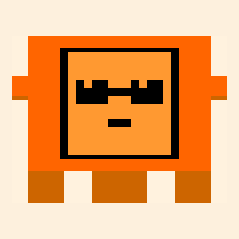<br><code>spare-slack</code> 摸鱼中</td>
    <td align="center"><br><code>spare-grin</code> 大笑</td>
  </tr>
  <tr>
    <td align="center">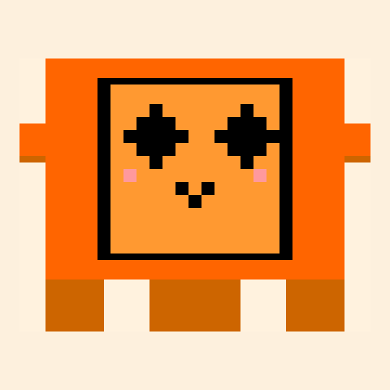<br><code>spare-shine</code> 闪亮</td>
    <td align="center">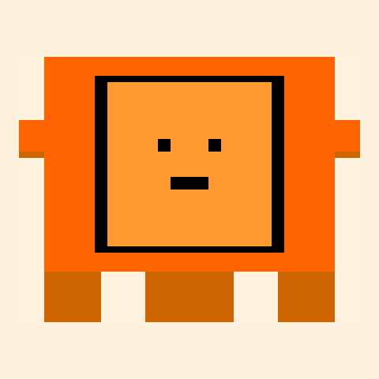<br><code>spare-blank</code> 无语</td>
  </tr>
</table>

参考图里只有六张脸，所以另外几张是补的：`error` 按同一套配色和像素风新画（XX 眼 + 下弯嘴），`sleep` 是待机中那张脸的"睡着版"（闭眼 + 冒 z），而 `grin`/`shine`/`blank` 是照着图底部那行"更多表情持续更新中…"里的小脸画的（第一个"眯眼笑"就是已有的 `happy`）。另外这套是照着**奶油底色**画的 —— 背景是运行时设置，把网页上的 Pet BG 调成 `#FDF0DD` 最接近参考图（或者串口/BLE 发 `bg#FDF0DD`，存在 NVS 里）。

装了 408 KB 的它，还剩约 2.0 MB 的分区余量 —— 这也是当初想加一套包时的动机之一。

重新生成素材、打包、预览：

```bash
python3 tools/origin_art.py --pack themes/origin        # 画 + 打包，一步
python3 tools/mochi_theme.py bundle themes/origin -o themes/origin.zip
python3 tools/mochi_theme.py preview themes/origin -o /tmp/origin.png --bg '#FDF0DD'
```

`origin_art.py -o /tmp/origin-gifs` 只画 GIF 不打包；`--sheet DIR` 另外把每个状态的所有帧铺成一张 PNG，用来检查动作（GIF 播放器只看得到第一帧）。

### Logo 动画时长

```cpp
// 在 animLogoReveal() 里 —— logo 完全展开后停留多久
delayMs(1500);     // 毫秒 —— 改这个数

// 展开每一步之间
delayMs(24);       // 越小越快
```

这段展开有自己的固定节奏，不跟随网页上的任何设置：它是一次性的开机小演出，不是宠物的动画。

---

## 参与贡献

非常欢迎贡献！一些方向：

- **新动画** —— 增加新的表情、过渡或空闲动作
- **新界面** —— 天气、时钟、通知角标、像素画场景
- **声音** —— 加一个小蜂鸣器做音效
- **传感器** —— 接触摸传感器或按钮做实体交互
- **OTA 升级** —— 支持无线升级固件
- **MQTT / Home Assistant** —— 接入智能家居平台

参与方式：fork 本仓库、改好、提 PR。改动请针对 `esp-idf/` —— 那是设备实际在跑的固件；`clawd_mochi.ino` 作为最初版本的存档保留。

## 许可证

本项目使用 MIT 许可证 —— 详见 [LICENSE](LICENSE)。

**注意：** 3D 模型与媒体素材使用 **CC BY-NC-SA 4.0** 许可证。

---

## Star History

[](https://www.star-history.com/#yousifamanuel/clawd-mochi)
