# 主题包

**English: [README.en.md](README.en.md)** — 本文件是默认版本；两份如有出入，以这份为准。

设备上**一次只装一套**主题（2.44 MB 的存储分区放不下第二套），"换主题"就是替换。一套主题是这里的**一个包**：

```
themes/<名字>/          # 源目录：manifest.txt + 每个状态一个 .caf
themes/<名字>.zip       # 打包给设备的那一个文件（tools/mochi_theme.py bundle）
```

`.caf` 是二进制动画（由 `tools/gif2caf.py` 从 GIF 转换而来），`.zip` 才是设备收的东西 —— 网页里选包、推送，设备自己解压。包目录会被整个打进 zip 并展开到设备分区上，所以**目录里只放包本身**：预览图、说明都留在目录外（见每节末尾）。

| 包 | 状态 | 解压后 | zip | 角色 |
| --- | --- | --- | --- | --- |
| [`clawd.zip`](clawd.zip) | 12 | 2054 KB | 384 KB | 上游贴图集里的螃蟹 |
| [`origin.zip`](origin.zip) | 11 | 408 KB | 8 KB | 橙色方块宠，素材是用代码画出来的 |
| [`calico.zip`](calico.zip) | 10 | 1506 KB | 725 KB | 三花猫（上游 `calico`） |
| [`cloudling.zip`](cloudling.zip) | 10 | 572 KB | 235 KB | 云朵（上游 `cloudling`） |
| [`face.zip`](face.zip) | 12 | 338 KB | 7 KB | 只有表情，整屏黑边（`origin` 那张脸的另一种外壳）—— **出厂外观** |

---

## `clawd` —— 螃蟹（12 个状态）

**前六个由 Claude Code 驱动**：`idle` 空闲、`thinking` 提交了提示、`working` 工具在跑、`done` 一轮结束、`error` 出错（目前没有自动来源，只能手动播）、`sleep` 静置打盹。

<table>
  <tr>
    <td align="center"><br><code>idle</code></td>
    <td align="center"><br><code>thinking</code></td>
    <td align="center"><br><code>working</code></td>
  </tr>
  <tr>
    <td align="center"><br><code>done</code></td>
    <td align="center"><br><code>error</code></td>
    <td align="center"><br><code>sleep</code></td>
  </tr>
</table>

**后六个是备用素材** —— 改 `clawd/manifest.txt` 里某个状态指向它们即可（例如 `idle=clawd-idle.caf`）：

<table>
  <tr>
    <td align="center"><br><code>spare-idle</code></td>
    <td align="center"><br><code>spare-reading</code></td>
    <td align="center"><br><code>juggling</code></td>
  </tr>
  <tr>
    <td align="center"><br><code>notification</code></td>
    <td align="center"><br><code>sweeping</code></td>
    <td align="center"><br><code>carrying</code></td>
  </tr>
</table>

素材来自上游贴图集（仓库外的 `../stickers/`）。重新打包：

```bash
python3 tools/mktheme.py ../stickers/240/clawd -o themes/clawd
python3 tools/mochi_theme.py bundle themes/clawd -o themes/clawd.zip
```

## `origin` —— 橙色方块宠（11 个状态）

产品图上那只角色：方脑袋、两侧小耳朵、正面一块黑框屏幕、下面三条腿，表情画在屏幕里。它的美术**没有上游来源**，是 `tools/origin_art.py` 逐帧画出来的像素画（想改样子就改那个脚本里的常数，然后 `--pack`）。

<table>
  <tr>
    <td align="center"><br><code>idle</code> 待机中</td>
    <td align="center"><br><code>thinking</code> 思考中</td>
    <td align="center"><br><code>working</code> 工作中</td>
  </tr>
  <tr>
    <td align="center"><br><code>done</code> 完成啦</td>
    <td align="center"><br><code>error</code> 出错</td>
    <td align="center"><br><code>sleep</code> 打盹</td>
  </tr>
</table>

<table>
  <tr>
    <td align="center"><br><code>spare-happy</code> 开心</td>
    <td align="center"><br><code>spare-slack</code> 摸鱼中</td>
    <td align="center"><br><code>spare-grin</code> 大笑</td>
  </tr>
  <tr>
    <td align="center"><br><code>spare-shine</code> 闪亮</td>
    <td align="center"><br><code>spare-blank</code> 无语</td>
  </tr>
</table>

这套是照**奶油底色**画的，把宠物背景（网页 Pet BG，或串口 `bg#FDF0DD`）调成 `#FDF0DD` 最接近参考图。重新生成：

```bash
python3 tools/origin_art.py --pack themes/origin      # 画 + 打包，一步
python3 tools/mochi_theme.py bundle themes/origin -o themes/origin.zip
python3 tools/mochi_theme.py preview themes/origin -o /tmp/origin.png --bg '#FDF0DD'
```

## `calico` —— 三花猫（10 个状态）

上游桌面版 clawd-on-desk 的三个角色之一（它自己的 `themes/calico`），贴图集在仓库外的 `../stickers/128/calico`。坐着发呆、思考时爪子托腮、工作时趴在键盘上、完成时举手撒花、出错时躺倒（XX 眼 + 创可贴）、睡觉时侧躺翻肚皮；四个备用素材是玩球、冒感叹号、扫地、叼鱼。

<table>
  <tr>
    <td align="center">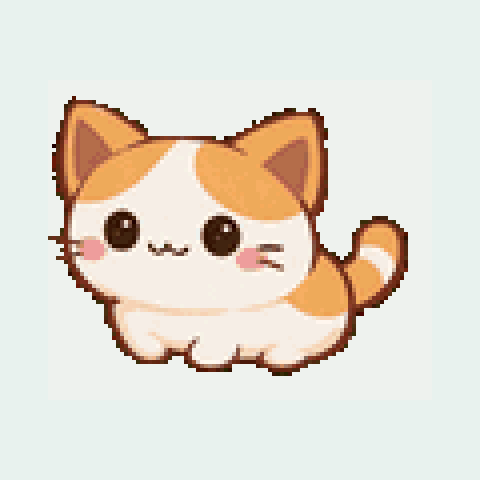<br><code>idle</code> 发呆</td>
    <td align="center"><br><code>thinking</code> 思考</td>
    <td align="center"><br><code>working</code> 敲键盘</td>
  </tr>
  <tr>
    <td align="center">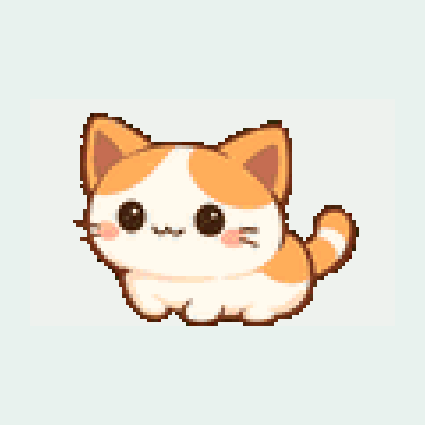<br><code>done</code> 撒花</td>
    <td align="center"><br><code>error</code> 躺倒</td>
    <td align="center"><br><code>sleep</code> 翻肚皮</td>
  </tr>
</table>

<table>
  <tr>
    <td align="center"><br><code>spare-juggling</code> 玩球</td>
    <td align="center">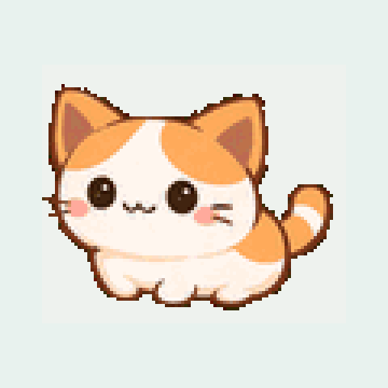<br><code>spare-notification</code> 提醒</td>
    <td align="center">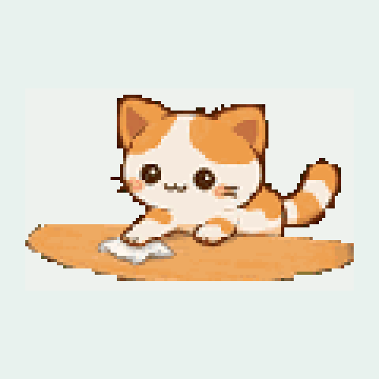<br><code>spare-sweeping</code> 扫地</td>
    <td align="center">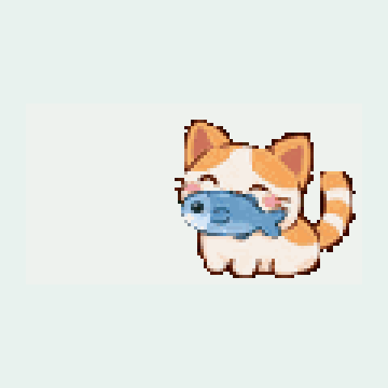<br><code>spare-carrying</code> 叼鱼</td>
  </tr>
</table>

```bash
python3 tools/mktheme.py ../stickers/128/calico -o themes/calico \
        --scale 2 --no-upscale --spares juggling,notification,sweeping,carrying
python3 tools/recenter_pack.py themes/calico
python3 tools/mochi_theme.py bundle themes/calico -o themes/calico.zip
python3 tools/theme_gifs.py themes/calico pics/calico
```

## `cloudling` —— 云朵（10 个状态）

同一套里的云朵。它**没有 `-happy`**，所以 `done` 按上游的做法指向 `attention`（云被点亮一下）。发呆时是一小团云、思考时举着放大镜、工作时敲工具、出错时整朵变乌云（XX 眼）、睡觉时戴睡帽；备用素材是抛小球、冒感叹号、扫地、搬东西。

<table>
  <tr>
    <td align="center">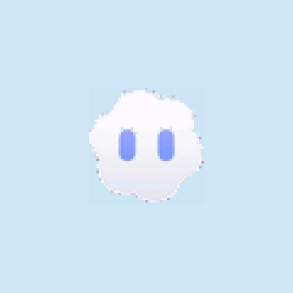<br><code>idle</code> 发呆</td>
    <td align="center"><br><code>thinking</code> 思考</td>
    <td align="center"><br><code>working</code> 干活</td>
  </tr>
  <tr>
    <td align="center"><br><code>done</code> 点亮</td>
    <td align="center"><br><code>error</code> 乌云</td>
    <td align="center"><br><code>sleep</code> 睡帽</td>
  </tr>
</table>

<table>
  <tr>
    <td align="center">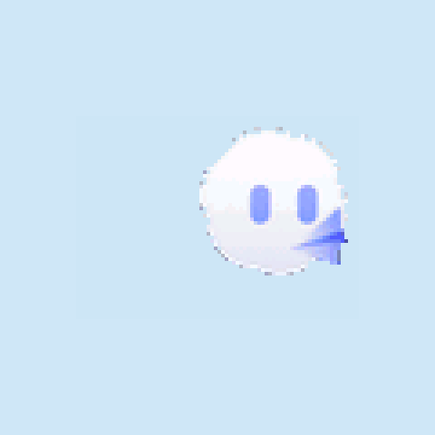<br><code>spare-juggling</code> 抛球</td>
    <td align="center">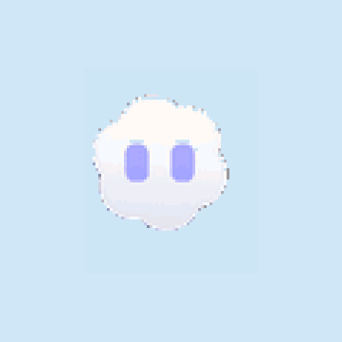<br><code>spare-notification</code> 提醒</td>
    <td align="center">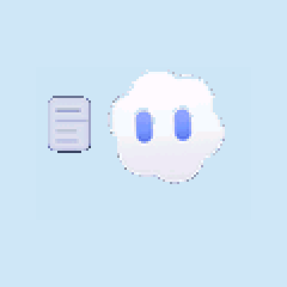<br><code>spare-sweeping</code> 扫地</td>
    <td align="center">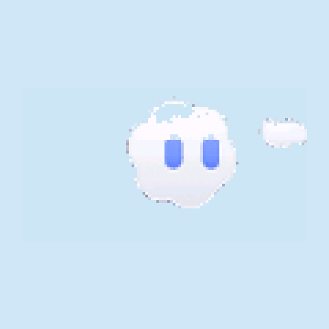<br><code>spare-carrying</code> 搬东西</td>
  </tr>
</table>

它是一团白云，在出厂那层淡薄荷底上对比度很低 —— 上面这些预览是放在浅蓝（`#cfe7f7`）上渲染的，面板上也建议把 Pet BG 调成类似的蓝（网页里选，或串口 `bg#cfe7f7`，存在 NVS 里）。

```bash
python3 tools/mktheme.py ../stickers/128/cloudling -o themes/cloudling \
        --scale 2 --no-upscale --map done=attention \
        --spares juggling,notification,sweeping,carrying
python3 tools/recenter_pack.py themes/cloudling
python3 tools/mochi_theme.py bundle themes/cloudling -o themes/cloudling.zip
python3 tools/theme_gifs.py themes/cloudling pics/cloudling '#cfe7f7'
```

## 位置：这两个包为什么要多跑一步 `recenter_pack.py`

转换器把画面居中在**源 GIF 的画布**里，并把那个角当作面板坐标存进包；设备则是按 manifest 的 `scale` **从那个角**放大推送的。素材画布不是面板大小时，两边就对不上：这两套贴图集是 128×128 画布、按 scale 2 播放，照转换器的原样算出的位置会让宠物偏左上（云朵最明显 —— 47×48 的画放大两倍后落在 (40,40)，偏了 33 px；猫偏 13–19 px）。

`tools/recenter_pack.py` 只重写每个 `.caf` 表头里那两个坐标，按"放大后的尺寸在面板上居中"重算 —— 画面内容、调色板、帧数、每帧时长都不动。`clawd` 和 `origin` 不需要这一步：它们的素材本来就画在 240 画布上（`scale=1`），转换器算出来的就是面板坐标。

改用 240 画布那套贴图集（`../stickers/240/...`）配 `scale=1` 本来就能居中，但体积是：calico 六个状态 **2926 KB**（超过 2400 KB 预算，装不下），cloudling 六个状态 1997 KB（装得下，但一个备用素材都放不下）。所以这两个包选择"128 画布 + scale 2 + 居中"。

校验器认得这两种位置：`verify_caf.py` 对这两个包报 `OK ... (recentred)`，对 `clawd`/`origin`/`face` 报普通的 `OK`。`scale=1` 时两种位置本来就重合，所以这条判定不会放过真问题 —— 它区分的是"转换器算的位置"和"放大推送的包该存的位置"，两者只有 `scale>1` 才会分开。

## `face` —— 只有表情，整屏黑边（12 个状态）

同一套脸、同一个生成器（`tools/origin_art.py`）的另一种外壳：**不要宠物，只要屏幕**，而且屏幕铺满整块面板 —— 黑边只有 2 px、橙色屏 236×236 填到边，表情按 16 px 单位格画（`origin` 是 8 px，所以这是它的两倍：208×192，居中）。六个 hook 状态 + 六个备用，脸与 `origin` 一致 —— 除了 `working`：这套保留渲染图里那三个 `</>` 字形，去掉它们下面那行滚动代码（在整屏尺度上那行是第二个更热闹的主体），改为**眼睛一眨一眨**：两个尖括号是眼睛，眨的时候收成横杠，中间那道斜杠不眨（跟着眨就成了整个记号在闪）；下面三个点一个一个亮起来再循环，是加载中 —— 原版用那行滚动代码和光标说的就是这件事。多出来的那张备用表情 `spare-ponder` 是渲染图里的另一对眼睛：左边眯着的方括号、右边睁大的方环，比本套其它脸更精细（4 px 一格），配居中的嘴点和两颊腮红。

<table>
  <tr>
    <td align="center"><br><code>idle</code> 待机中</td>
    <td align="center">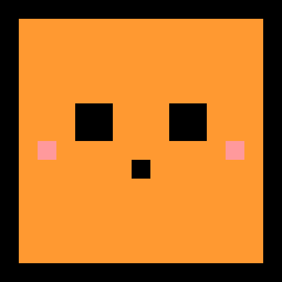<br><code>thinking</code> 思考中</td>
    <td align="center"><br><code>working</code> 工作中</td>
  </tr>
  <tr>
    <td align="center">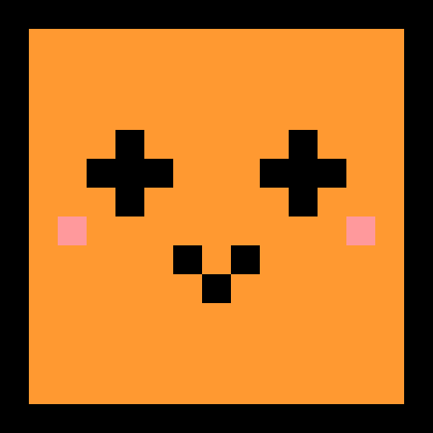<br><code>done</code> 完成啦</td>
    <td align="center">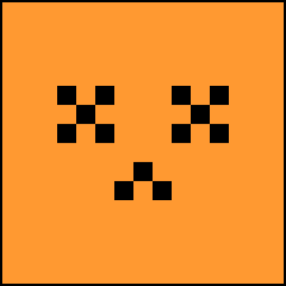<br><code>error</code> 出错</td>
    <td align="center">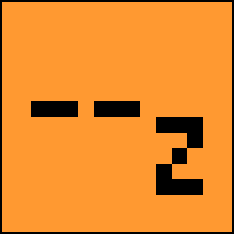<br><code>sleep</code> 打盹</td>
  </tr>
</table>

<table>
  <tr>
    <td align="center">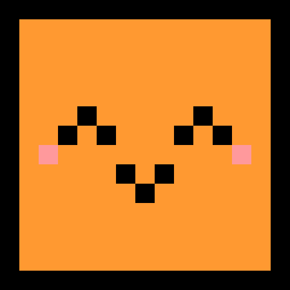<br><code>spare-happy</code> 开心</td>
    <td align="center"><br><code>spare-slack</code> 摸鱼中</td>
    <td align="center">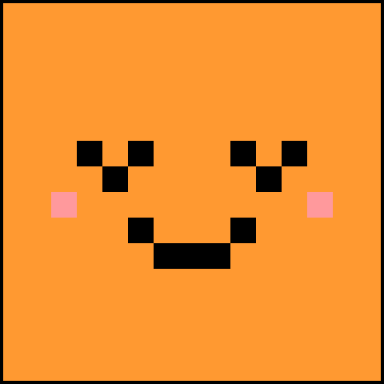<br><code>spare-grin</code> 大笑</td>
    <td align="center">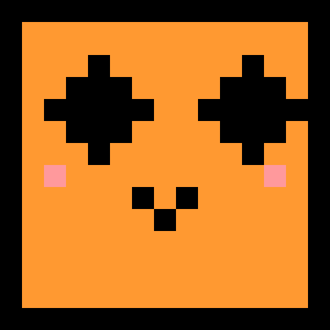<br><code>spare-shine</code> 闪亮</td>
    <td align="center">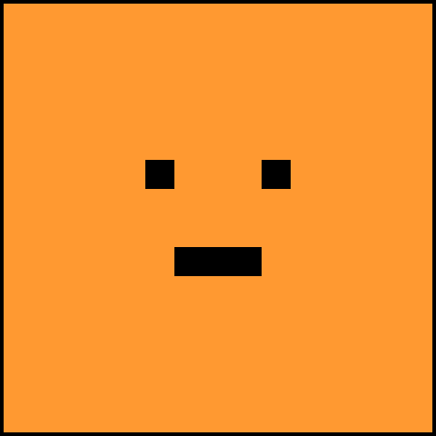<br><code>spare-blank</code> 无语</td>
    <td align="center">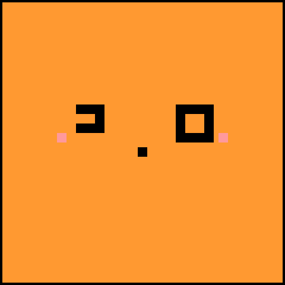<br><code>spare-ponder</code> 沉思</td>
  </tr>
</table>

`origin_art.py --shell` 决定画多少：`full` 整只宠物（`origin` 用的）、`frame` 屏幕带黑框、`bare` 只有脸、`panel` 整屏黑边（这套用的）。脸本身在哪种外壳里都一模一样，只有周围的东西没了。

```bash
python3 tools/origin_art.py --shell panel --prefix face --pack themes/face
python3 tools/mochi_theme.py bundle themes/face -o themes/face.zip
python3 tools/theme_gifs.py themes/face pics/face
```

**这套不看 Pet BG。** 整块画面都是实体像素，没有一处透明 —— `.caf` 里那个"场地色"在这套里根本不存在，所以背景设成什么都不会显示。别的主题都得挑一个配它的背景（`origin` 要奶油、`cloudling` 要浅蓝），这套是唯一不需要的。

## 预览图怎么来的

上面每一张都**不是素材 GIF**，而是从设备真正播放的 `.caf` 逐帧解码、按固件的合成规则渲染出来的（480×480，面板的 2 倍）—— 也就是面板上实际的效果。所以改了包之后要重新跑一次：

```bash
python3 tools/theme_gifs.py themes/clawd    pics/states
python3 tools/theme_gifs.py themes/origin   pics/origin '#fdf0dd'
python3 tools/theme_gifs.py themes/calico   pics/calico
python3 tools/theme_gifs.py themes/cloudling pics/cloudling '#cfe7f7'
python3 tools/theme_gifs.py themes/face    pics/face
```

它们放在 `pics/` 而不是各自的包目录里：包目录会被整个打进 zip、展开到设备的分区上，多一个文件就是白占存储。

## 固件里内置的那份

`esp-idf/main/default_pack.zip`（7 KB，展开 338 KB）装的是 `face` 的**全部 12 个状态** —— 出厂就有脸，不用推任何东西。这套是整屏平涂色块，压缩率极高，所以连 6 个备用表情都放得下；换回 `clawd` 的话 12 个状态要 384 KB，只有 6 个 hook 状态进得去。开机时如果存储分区里没有 manifest，固件就把它展开过去；网页上的 `restore built-in` 做的是同一件事。

## 装到设备上

1. 连设备热点 `Clawd-Mochi`（默认密码 `clawd1234`），打开 `http://192.168.4.1`
2. `// theme` 区 → 选一个 `.zip` 加进主题库 → push
3. 传输完成不等于结束：设备要按 littlefs 的 128 字节粒度把它写进分区，约 **78 KB/s** —— `origin`（408 KB）约 4 秒，`clawd`（2054 KB）约 25 秒，网页会数着秒告诉你

失败或被拒（比如包比分区还大）不会留下空主题：设备会把内置那套装回去。整体设计与取舍见 [../CLAUDE-CODE-BRIDGE.md](../CLAUDE-CODE-BRIDGE.md)。
